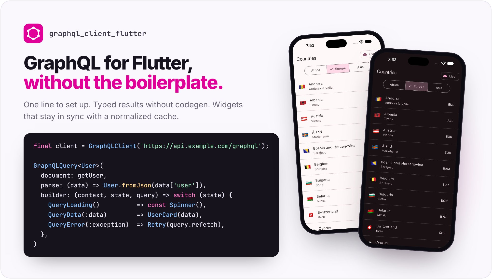
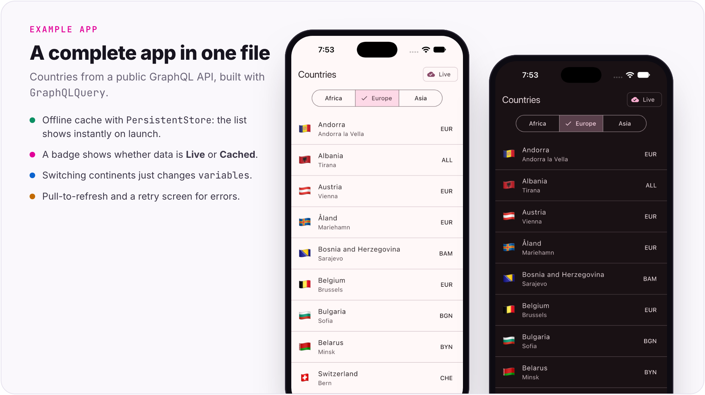
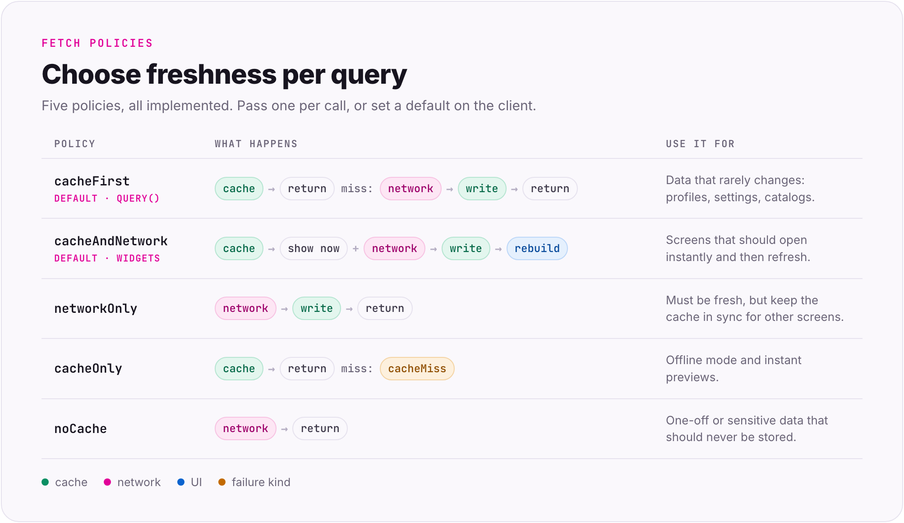
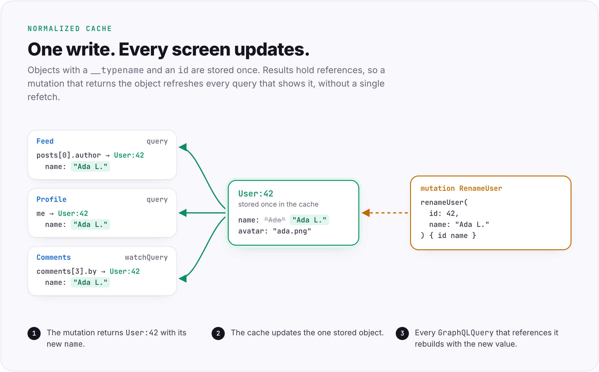
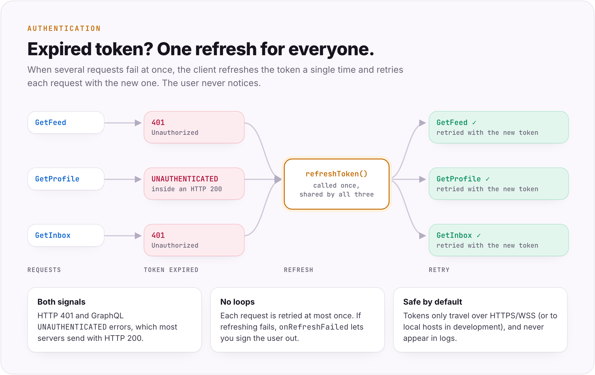
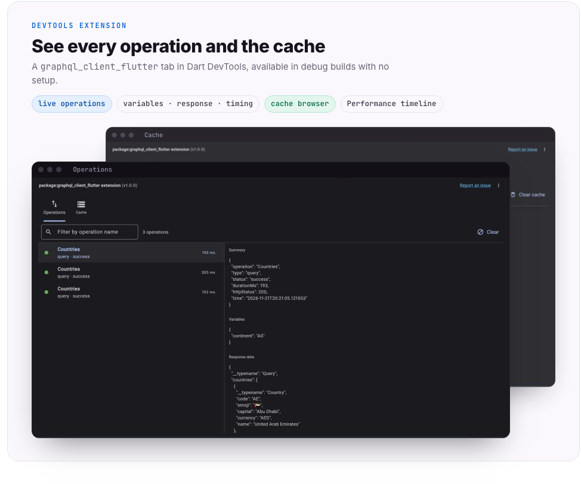
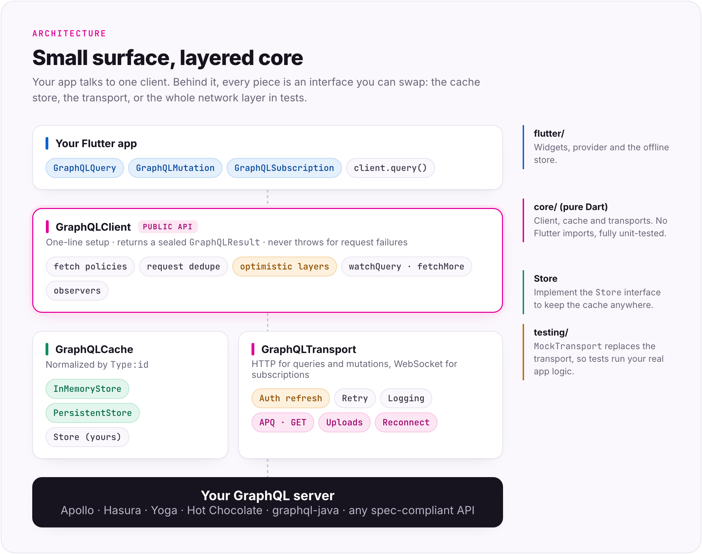

<p align="center">
  
</p>

<p align="center">
  <a href="https://pub.dev/packages/graphql_client_flutter"></a>
  <a href="https://pub.dev/packages/graphql_client_flutter/score"></a>
  <a href="https://pub.dev/packages/graphql_client_flutter/score"></a>
  <a href="https://github.com/Ahmed-Reda-Dev/graphql_client_flutter/actions/workflows/ci.yaml"></a>
  <a href="LICENSE"></a>
</p>

# graphql_client_flutter

**The simple, typed GraphQL client for Flutter.** Set it up in one line, get typed results without code generation, and let widgets update themselves when your data changes.

```dart
final client = GraphQLClient('https://api.example.com/graphql');

final result = await client.query(
  getUser,
  variables: {'id': '1'},
  parse: (data) => User.fromJson(data['user']),
);

switch (result) {
  case GraphQLSuccess(:final data): print(data.name);
  case GraphQLFailure(:final exception): print(exception.userMessage);
}
```

## Why this package

| Feature | What you get |
|---|---|
| ⚡ **One-line setup** | `GraphQLClient(url)` comes with retries, timeouts and a normalized cache. |
| 🧩 **Typed without codegen** | `parse:` turns the response into your own models. Generated code plugs in too. |
| 🛡️ **No try/catch** | Every call returns a sealed `GraphQLResult`, and failures carry a `kind` and a ready-to-show `userMessage`. |
| 🔄 **Widgets that stay in sync** | A mutation that changes an object updates every `GraphQLQuery` that shows it. |
| 🔐 **Auth that just works** | Tokens refresh on HTTP 401 *and* `UNAUTHENTICATED`, once for all pending requests. |
| 📡 **Resilient subscriptions** | Auto-reconnect with backoff, dead-connection detection, both WebSocket protocols. |
| 📴 **Offline-first** | Mutations made offline wait in a persisted queue and send themselves later. The cache persists on every platform (optionally encrypted), with `maxAge`, stale-if-error and a size limit. |
| 🔋 **Lifecycle-aware** | Polling pauses in the background, and queries refresh when the app returns or the network comes back. |
| 🚀 **Fast by default** | Request deduplication, automatic batching, persisted queries and GET for CDNs. |
| 🔍 **DevTools extension** | Inspect live operations and browse the cache in a Dart DevTools tab. |
| 🧪 **Testable by design** | Record real server responses once and replay them in tests, or write canned replies with `MockTransport`. |

## Contents

- [Install](#install) · [Quick start](#quick-start) · [Example app](#example-app)
- [Queries](#queries) · [Mutations](#mutations) · [Subscriptions](#subscriptions) · [Widgets](#widgets)
- [Offline-first](#offline-first) · [Errors](#errors) · [Cache](#cache) · [Authentication](#authentication) · [Pagination](#pagination)
- [File uploads](#file-uploads) · [Performance](#performance) · [Logging and observers](#logging-and-observers)
- [DevTools](#devtools) · [Testing](#testing) · [Code generation](#code-generation) · [Architecture](#architecture)
- [Good to know](#good-to-know) · [Migrating from 1.x](#migrating-from-1x) · [Contributing](#contributing)

## Install

```bash
flutter pub add graphql_client_flutter
```

Works on Android, iOS, web, macOS, Windows and Linux. Requires Flutter 3.27+ (Dart 3.6+).

## Quick start

**1. Create a client** once, at startup:

```dart
final client = GraphQLClient(
  'https://api.example.com/graphql',
  subscriptionEndpoint: 'wss://api.example.com/graphql', // optional
  token: () => auth.accessToken,                          // optional
);
```

**2. Provide it** to your widgets:

```dart
runApp(GraphQLProvider(client: client, child: const MyApp()));
```

**3. Show data:**

```dart
const getUser = r'''
  query GetUser($id: ID!) {
    user(id: $id) { id name avatarUrl }
  }
''';

GraphQLQuery<User>(
  document: getUser,
  variables: {'id': userId},
  parse: (data) => User.fromJson(data['user']),
  builder: (context, state, query) => switch (state) {
    QueryLoading() => const CircularProgressIndicator(),
    QueryData(:final data) => Text(data.name),
    QueryError(:final exception) => TextButton(
        onPressed: query.refetch,
        child: Text('${exception.userMessage} Tap to retry.'),
      ),
  },
)
```

## Example app

<p align="center">
  
</p>

[`example/`](example) is a complete app in one file: countries from a public GraphQL API, with an offline cache, pull-to-refresh, error handling and a badge that shows whether the data is live or cached.

```bash
cd example && flutter run
```

## Queries

```dart
final result = await client.query(
  getUser,
  variables: {'id': '1'},
  parse: (data) => User.fromJson(data['user']),
);
```

Without `parse`, `data` is the raw JSON map: `client.query<JsonMap>(getUser)`.

<p align="center">
  
</p>

```dart
await client.query(getUser, fetchPolicy: FetchPolicy.networkOnly);
```

**Watch a query** to get a stream that updates whenever the cache changes:

```dart
final watch = client.watchQuery(
  getFeed,
  parse: (data) => Feed.fromJson(data['feed']),
);
watch.stream.listen((result) { ... });
await watch.refetch();
```

Identical queries in flight at the same time are sent only once, and a refetch that returns unchanged data does not rebuild your UI.

**Freshness with `maxAge`**: decide how long cached data stays fresh, per query or for the whole client:

```dart
// Older than 5 minutes? Fetch again, and still show the cached data if offline.
await client.query(getFeed, maxAge: const Duration(minutes: 5));

GraphQLClient(url, defaultMaxAge: const Duration(minutes: 5));
```

With `cacheFirst`, stale data is refetched, but if the server is unreachable the stale data is returned instead of an error (stale-if-error). With `cacheAndNetwork`, fresh data is shown without a network request. `watchQuery` and `GraphQLQuery` accept `maxAge` too.

## Mutations

```dart
final result = await client.mutate(
  r'mutation Like($id: ID!) { likePost(id: $id) { id likes likedByMe } }',
  variables: {'id': post.id},
);
```

<p align="center">
  
</p>

**Optimistic UI**: show the result immediately, and roll it back automatically if the request fails:

```dart
await client.mutate(
  likePost,
  variables: {'id': post.id},
  optimisticResponse: {
    'likePost': {'__typename': 'Post', 'id': post.id, 'likes': post.likes + 1, 'likedByMe': true},
  },
);
```

**Add created items to lists** with `update`:

```dart
await client.mutate(
  createTodo,
  variables: {'title': title},
  update: (cache, data) {
    final list = cache.read(getTodos)!;
    cache.write(getTodos, {
      'todos': [...list['todos'], data['createTodo']],
    });
  },
);
```

Or refetch watched queries by name: `refetchQueries: ['GetTodos']`. Mutations are never retried automatically, because a retried mutation could run twice.

## Subscriptions

```dart
client
    .subscribe(
      r'subscription OnMessage($room: ID!) { messageAdded(room: $room) { id text } }',
      variables: {'room': roomId},
      parse: (data) => Message.fromJson(data['messageAdded']),
    )
    .listen((result) { ... });
```

- **Protocols:** speaks `graphql-transport-ws` by default. For older servers, pass `subscriptionProtocol: SubscriptionProtocol.subscriptionsTransportWs`.
- **One socket:** it opens with the first subscription and closes shortly after the last one.
- **Recovery:** after a drop it reconnects with exponential backoff and restarts your subscriptions. A connection that stops answering pings is replaced. Fatal errors such as unauthorized are not retried.
- **Cancelling:** cancelling the stream subscription stops the operation on the server.

## Widgets

| Widget | Purpose |
|---|---|
| `GraphQLProvider` | Makes a client available below it (`context.graphQLClient`). |
| `GraphQLQuery<T>` | Runs a query and rebuilds on every change. The builder gets a `QueryState<T>` and a controller with `refetch()` and `fetchMore()`. |
| `GraphQLMutation<T>` | Gives the builder a `run(...)` function and a `MutationState<T>`: idle, running, success or failure. |
| `GraphQLSubscription<T>` | Subscribes while mounted and rebuilds with each event. |

```dart
GraphQLMutation<Post>(
  document: createPost,
  parse: (data) => Post.fromJson(data['createPost']),
  refetchQueries: const ['Feed'],
  onCompleted: (post) => Navigator.pop(context),
  builder: (context, state, run) => FilledButton(
    onPressed: state is MutationRunning ? null : () => run(variables: {'title': title}),
    child: const Text('Publish'),
  ),
)
```

- **Pull-to-refresh** is one line: `RefreshIndicator(onRefresh: query.refetch, child: ...)`.
- **Changing `variables`** loads the new result.
- **An inline `parse` closure** does not restart the query.
- **An invalid document** renders as `QueryError` instead of throwing during build.

## Offline-first

**Mutations that wait for the network.** With `queueIfOffline: true`, a mutation the server can't be reached for is kept, and sent on its own once the network is back. The optimistic response stays on screen meanwhile, and the returned future completes when the server answers:

```dart
final id = uuid(); // a client-generated id makes a resend harmless
final result = await client.mutate(
  addTodo,
  variables: {'id': id, 'title': title},
  optimisticResponse: {'addTodo': {'__typename': 'Todo', 'id': id, 'title': title}},
  queueIfOffline: true,
);
```

- Waiting mutations are sent one at a time, in the order they were made.
- They are saved with the cache, so they survive restarts. With a `PersistentStore` codec, they are encrypted too.
- A mutation stays queued while a later try may succeed: the server is unreachable, times out, fails (5xx) or asks for credentials (401, for example before the token is restored at startup). It leaves the queue once the server accepts or rejects it.
- Every attempt is reported to your `GraphQLObserver`s, including attempts for mutations restored after a restart, which no caller is waiting for.
- `resetStore()` discards the queue, so one user's changes are never sent as another user's.
- Opt in only for mutations that are safe to send later. Payments, for example, are not.

Show what's waiting:

```dart
StreamBuilder<int>(
  stream: client.offlineQueue.changes,
  initialData: client.offlineQueue.length,
  builder: (context, count) => Text('${count.data} changes waiting to sync'),
);
```

The queue retries after any successful request, on a backoff timer, and when the app returns to the foreground. To also retry the moment the network comes back, report connectivity to the client, for example with [`connectivity_plus`](https://pub.dev/packages/connectivity_plus):

```dart
Connectivity().onConnectivityChanged.listen((results) {
  client.setOnline(!results.contains(ConnectivityResult.none));
});
```

**App lifecycle.** `GraphQLProvider` tells the client when the app goes to the background, with no setup needed:

- While hidden or offline, watched queries stop polling.
- When the app returns, each watched query refreshes under the same rule it started with. A `cacheAndNetwork` query refreshes, and a `cacheFirst` query refreshes only if its data is older than `maxAge`.

Without `GraphQLProvider`, call `client.setAppVisible(bool)` yourself.

## Errors

Operations never throw for request failures. A failure carries a `GraphQLException` with:

- **`kind`:** `network`, `timeout`, `cancelled`, `unauthenticated`, `forbidden`, `invalidRequest`, `server`, `graphql`, `invalidResponse`, `cacheMiss` or `unknown`
- **`userMessage`:** short text you can show in the UI
- **`errors`:** the server's GraphQL errors, if any
- **`statusCode`, `operationName` and `cause`:** for logging

```dart
if (result case GraphQLFailure(:final exception)) {
  switch (exception.kind) {
    case GraphQLErrorKind.unauthenticated: router.go('/login');
    case GraphQLErrorKind.network: showOfflineBanner();
    default: showSnackBar(exception.userMessage);
  }
}
```

Helpers: `result.dataOrNull`, `result.dataOrThrow`, `result.map(...)`, `result.when(success: ..., failure: ...)`.

**Partial data:** by default (`ErrorPolicy.none`) any GraphQL error makes the result a failure. Use `ErrorPolicy.all` to get data and errors together, or `ErrorPolicy.ignore` to drop errors when data exists.

## Cache

Objects with `__typename` and `id` are stored once under `Type:id`. The client adds `__typename` to your queries automatically.

```dart
final client = GraphQLClient(
  url,
  cache: GraphQLCache(
    store: await PersistentStore.open(), // survives restarts, works offline
    typePolicies: {
      'Book': TypePolicy(keyFields: {'isbn': true}), // identified by something other than id
    },
  ),
);
```

**Offline cache and privacy.** `PersistentStore` writes plain JSON to the app's support directory. For sensitive data:

```dart
PersistentStore.open(
  name: 'cache_$userId',        // one file per user
  codec: myEncryptionCodec,     // Codec<String, String>, e.g. AES with a key from flutter_secure_storage
);

await client.resetStore();      // on logout: clears memory and disk before returning
```

**Size limit.** `GraphQLCache(maxEntities: 5000)` keeps at most that many objects. The least recently used ones are evicted first, and a query whose objects were evicted is simply fetched again. Set the limit well above what one screen shows.

On the web, `PersistentStore` saves to `localStorage` with the same API. Browsers allow about 5 MB per site, and a write over the quota is reported to `onWriteError` while the in-memory cache keeps working.

Direct access:

```dart
client.cache.readFragment('fragment U on User { name }', idFields: {'__typename': 'User', 'id': '1'});
client.cache.writeFragment(...);
client.cache.evict('User:1');   // watching queries refetch once
client.cache.gc();              // drop objects nothing references
```

## Authentication

<p align="center">
  
</p>

```dart
final client = GraphQLClient(
  url,
  token: () => storage.read('access_token'),
  refreshToken: () async {
    final tokens = await authApi.refresh();
    return tokens?.accessToken; // null = could not refresh
  },
  onRefreshFailed: (_) => auth.signOut(),
);
```

- **What gets sent:** `Authorization: Bearer <token>` on every request.
- **Where it goes:** the token is only sent over `https://` / `wss://`, or to local and private hosts (`localhost`, `10.0.2.2`, `192.168.x.x`) for development. Pass `allowInsecureAuth: true` to override this.
- **Over WebSocket:** `connection_init` carries only `{'Authorization': 'Bearer <token>'}`, read again on every reconnect. HTTP `headers` are not copied to it. For a custom payload, pass `subscriptionConnectionParams: () async => {...}`.

## Pagination

For [Relay-style connections](https://relay.dev/graphql/connections.htm) (`edges` or `nodes` plus `pageInfo`), `RelayPagination` does the bookkeeping:

```dart
const posts = RelayPagination('user.posts'); // where the connection is in the data

final query = client.watchQuery<JsonMap>(postsQuery); // selects pageInfo { hasNextPage endCursor }

// When the list reaches its end:
final data = query.latest!.dataOrThrow;
if (posts.hasNextPage(data)) {
  await query.fetchMore(
    variables: posts.nextPageVariables(data)!, // {'after': endCursor}
    merge: posts.merge,                         // appends edges, updates pageInfo
  );
}
```

`GraphQLQuery`'s builder gets the same `query.fetchMore`. For other pagination styles, pass your own `merge`:

```dart
query.fetchMore(
  variables: {'offset': items.length},
  merge: (previous, more) => {
    'items': [...previous['items'], ...more['items']],
  },
);
```

Calling `fetchMore` again while a page is loading returns that same page, so scroll listeners can call it freely.

## File uploads

Put a `MultipartFile` anywhere in the variables. The request is encoded following the [GraphQL multipart request spec](https://github.com/jaydenseric/graphql-multipart-request-spec):

```dart
await client.mutate(
  r'mutation Upload($file: Upload!) { uploadAvatar(file: $file) { url } }',
  variables: {'file': await MultipartFile.fromFile(path, filename: 'avatar.jpg')},
);
```

## Performance

```dart
GraphQLClient(
  url,
  persistedQueries: true,   // Automatic Persisted Queries: send a hash instead of the query text
  useGetForQueries: true,   // GET for queries, so CDNs can cache them
  timeout: const Duration(seconds: 15),
  maxRetries: 3,            // network errors, timeouts, 429 (honours Retry-After), 5xx
  batch: const BatchOptions(), // queries started within 10 ms share one HTTP request
);
```

**Batching** sends queries started close together (for example, several widgets loading at once) as one JSON-array request. It needs server support (Apollo Server's `allowBatchedHttpRequests`, Hasura, graphql-java and others). If the server doesn't answer with an array, the client resends the queries individually and stops batching. Mutations and uploads are never batched.

Cancel a request with a `CancellationToken`:

```dart
final token = CancellationToken();
final future = client.query(search, variables: {'q': text}, cancelToken: token);
token.cancel(); // completes with GraphQLErrorKind.cancelled
```

## Logging and observers

```dart
GraphQLClient(url, logging: true); // credentials, URL queries and bodies are never logged
```

For analytics or tracing, implement only the callbacks you need:

```dart
class Analytics extends GraphQLObserver {
  @override
  void onResponse(GraphQLRequest request, GraphQLResponse response, Duration elapsed) =>
      metrics.timing('graphql.${request.operationName}', elapsed);
}

GraphQLClient(url, observers: [Analytics()]);
```

## DevTools

<p align="center">
  
</p>

Run your app in debug mode, open Dart DevTools, and enable the **graphql_client_flutter** extension (DevTools asks once per project).

- **Operations:** every query, mutation and subscription as it happens, with variables, response data, errors and timing.
- **Cache:** browse and search the normalized cache of each client, and clear it.
- **Performance tab:** each operation appears on the timeline next to your frames.

The integration is compiled out of release builds, so it costs nothing in production.

## Testing

```dart
import 'package:graphql_client_flutter/testing.dart';

final mock = MockTransport()
  ..on('GetUser', variables: {'id': '1'}).reply({
    'user': {'__typename': 'User', 'id': '1', 'name': 'Ada'},
  })
  ..on('CreatePost').fail(GraphQLErrorKind.network)
  ..on('OnMessage').emit([{'messageAdded': {...}}]);

final client = GraphQLClient.custom(transport: mock);

// Use `client` in GraphQLProvider for widget tests, then assert:
expect(mock.requestsFor('GetUser'), hasLength(1));
```

Replies queue up: `..reply(a)..reply(b)` answers `a`, then `b` for every later call. An unmatched operation fails with a message listing what is registered.

**Record and replay real responses.** Instead of writing replies by hand, record what your server actually answers once, then replay it in every test without a network:

```dart
final record = Platform.environment['RECORD'] == '1';
const fixture = 'test/fixtures/home.json';

test('home screen data', () async {
  final transport = record
      ? RecordingTransport(HttpTransport('https://api.example.com/graphql'))
      : ReplayTransport(await Cassette.load(fixture));
  final client = GraphQLClient.custom(transport: transport);

  final result = await client.query(homeQuery);
  expect(result.isSuccess, isTrue);

  if (transport is RecordingTransport) await transport.cassette.save(fixture);
});
```

```bash
RECORD=1 flutter test test/home_test.dart   # refresh the recording
flutter test                                # replay, no network needed
```

- The recording is indented JSON, so it reads well in code review.
- It holds responses, GraphQL errors, transport failures and subscription events. Requests are matched by operation name, variables and query text, so a query you edit after recording tells you to record it again rather than replaying stale data.
- Request headers are never recorded. Variables and responses are saved as they were sent, so record with a test account and check fixtures for passwords, tokens and personal data before committing them.
- Record in a `test()`, not a `testWidgets()`: widget tests block real HTTP. Replaying works in both.

## Code generation

You don't need codegen. If you want fully generated types, use [graphql_codegen](https://pub.dev/packages/graphql_codegen) and pass its generated `fromJson` to `parse` (it takes the whole `data` object):

```dart
import 'package:gql/language.dart' show printNode;

final result = await client.query(
  printNode(documentNodeQueryGetUser),
  variables: Variables$Query$GetUser(id: '1').toJson(),
  parse: Query$GetUser.fromJson,
);
```

## Architecture

<p align="center">
  
</p>

`GraphQLClient` depends only on `GraphQLTransport` and `Store`, so you can compose or replace the network layer:

```dart
final client = GraphQLClient.custom(
  transport: SplitTransport(
    operations: HttpTransport(url, interceptors: [MyInterceptor()]),
    subscriptions: WebSocketTransport(wsUrl, maxReconnectAttempts: 10),
  ),
);
```

Custom Dio interceptors that re-send requests can mix in `DioAwareInterceptor`.

## Good to know

- **Batching** only helps when the server accepts batched requests; otherwise the client falls back to single requests on its own.
- **Browser storage** is limited to about 5 MB per site. For larger offline caches on the web, plug in your own `Store` (for example, one backed by IndexedDB).
- **Queued mutations are delivered at least once.** If the app is killed while one is in flight, it is sent again on the next start, so give mutations a client-generated id when duplicates matter. After a restart, a queued mutation's optimistic response comes back but its `update` callback does not.
- **`maxAge`** applies to query results. Individual objects stay in the cache until they are evicted, garbage-collected or replaced.

## Migrating from 1.x

Version 2 is a redesign that fixes v1's correctness problems. See [MIGRATION.md](MIGRATION.md) for a side-by-side guide.

## Contributing

Issues and pull requests are welcome. Before opening a PR, run what CI runs:

```bash
dart format --set-exit-if-changed .
flutter analyze --fatal-infos
flutter test --coverage
```

## License

[MIT](LICENSE)
